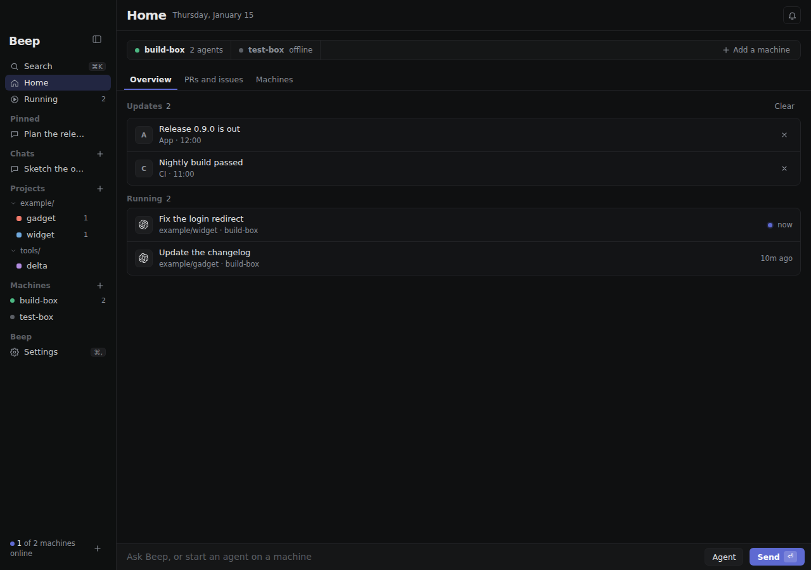

<h1 align="center">Beep</h1>

<p align="center">
  Run coding agents on every machine you own, from one desktop or your phone.
</p>

<p align="center">
  
</p>

Desktops, phones and `beep-node`s form a signed peer-to-peer mesh over iroh.
No server sits in the middle: a phone pairs with a desktop once, then reaches
your machines directly.

<p align="center">
  
</p>

## Get started

```sh
just desktop-dev      # run the desktop app
just desktop-build    # build it
just desktop-check    # type checks and tests
```

Add a machine from the desktop: it gives you a one-use ticket for `beep-node`.

## beep-node in Docker

Each node release publishes a small image (amd64 and arm64) with the static
binary, git, curl, a shell and CA certificates. It runs as uid 1000 and keeps
its key and mesh in `/data`.

```sh
docker run -d --restart unless-stopped --hostname build-box \
  -e BEEP_TICKET=... -v beep-node:/data registry.example/beep-node
```

- The ticket is used once; later starts reuse `/data`.
- The host name is the machine's name in the mesh.
- `BEEP_NODE_WORKSPACE` shares a folder with the rest of the mesh.
- Allow UDP 47120 through the firewall, or add `-p 47120:47120/udp`.
- Upgrade by pulling a newer tag. No coding agents are installed: build
  `FROM` this image and add the ones you use.

## Phones

The phone app is the desktop app built for iOS and Android. It pairs with a
desktop's phone code and joins the mesh as an observer.

```sh
just ios-sim-run      # iPhone simulator
just ios-run          # connected iPhone
just android-run      # connected device or emulator
```

iOS needs Xcode and `rustup target add aarch64-apple-ios aarch64-apple-ios-sim`.
Android needs the SDK and NDK with `ANDROID_HOME` and `NDK_HOME` set, and
`rustup target add aarch64-linux-android`.

## Windows

Windows x64 needs the WebView2 runtime. With Rust's MSVC toolchain, Visual
Studio C++ Build Tools and Node installed, `scripts/build-desktop-windows.ps1`
builds the NSIS installer. On Linux, `scripts/build-desktop-windows.sh` builds
a portable executable with cargo-xwin. Ctrl+Alt+Space opens the bar; desktop
control is unavailable.

## Report server

`beep-server` only receives the apps' problem reports.

```sh
cp config.example.toml config.toml
cargo run -p beep-server -- config.toml
```

Reports go to `[reports.r2]`, or to `[reports].folder` in development.
`deploy/compose.yaml` runs it on loopback port 47122 behind a TLS proxy.
`just reports`, `just report <id>` and `just report-solved <id>` manage them.

## Releases

`just patch <apps>` and `just minor <apps>` bump `desktop`, `beep-node`,
`android`, `ios` or `all`, freeze their changelogs, commit and push main with
the tags. `just release [apps]` does a patch bump; `--dry-run` checks versions.
Tags make CI build and publish each app. `just server-release <version>` tags
the server.

## Layout

```text
crates/proto/      wire types and framing
crates/mesh/       signed membership, tickets and replicated state
crates/fleet/      desktop projects, credentials and settings
crates/projects/   project code shared by node and desktop
crates/node/       beep-node: agents, files, sync and processes
crates/report/     problem reports
crates/server/     beep-server
apps/desktop/      Tauri app for macOS, Windows, iOS and Android
deploy/            container entrypoints and compose file
scripts/           build helpers
```
